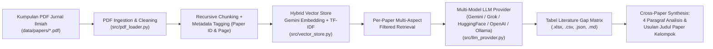

# RAG Pipeline for Automated Literature Gap Matrix & Research Proposal Synthesis (S2 AI)

Repositori ini berisi implementasi **Retrieval-Augmented Generation (RAG) Pipeline Multi-Model** untuk mengotomatisasi pembuatan **Literature Gap Matrix** serta menyusun **analisis sintesis dalam bentuk paragraf** guna merumuskan usulan paper kelompok.

* **Program Studi:** Magister (S2) Artificial Intelligence
* **Domain Fokus:** **Edukasi & Kesehatan Remaja (*Adolescent Health & Education*)** — Pencegahan dan Intervensi **Kecanduan Smartphone (*Smartphone/Screen Addiction*)** serta **Bahaya Merokok/Vaping (*Smoking & E-Cigarette Cessation*)**.
* **Publisher Referensi:** Elsevier, IEEE, Springer, Taylor & Francis, SAGE Publications.
* **Dukungan Multi-Model LLM:** Google Gemini, xAI Grok, Hugging Face (Llama 3.1, Qwen 2.5, Mistral), OpenAI (GPT-4o), Ollama Lokal (Llama 3.1), DeepSeek, & OpenRouter.

---

## Arsitektur Pipeline RAG Multi-Model



### Keunggulan Teknis:
1. **Multi-Model LLM Flexibility:** Pengguna dapat dengan mudah berpindah antar model LLM kelas dunia (**xAI Grok, Hugging Face Router, Google Gemini, OpenAI, Ollama lokal offline, DeepSeek**) hanya dengan mengubah satu baris di `.env` atau menambahkan argumen CLI.
2. **Per-Paper Metadata Filtering:** Mencegah *context contamination* (tercampurnya informasi antar jurnal PDF) saat melakukan *retrieval* untuk setiap baris matriks.
3. **Multi-Aspect Querying:** Setiap artikel di-*query* menggunakan 4 aspek spesifik secara terpisah (*Problem Statement*, *RAG Architecture & Methodology*, *Dataset & Evaluation Metrics*, dan *Limitations & Research Gap*).
4. **Hybrid Retrieval (Dense + Lexical):** Menggabungkan kemiripan semantik dengan pencocokan kata kunci teknis (*TF-IDF/BM25*) sehingga istilah spesifik seperti `RAGAS`, `Cross-Encoder`, `CBT`, atau `Motivational Interviewing` terambil secara presisi.
5. **Model-Aware Smart Caching:** Menyimpan cache hasil ekstraksi berdasarkan fingerprint SHA-256 dan model yang digunakan, sehingga pengujian berulang tidak memboroskan kuota API token.
6. **Structured Output (Pydantic Schema):** Menjamin hasil ekstraksi LLM selalu konsisten mengikuti skema 8 kolom standar *Literature Gap Matrix*.

---

## Struktur Direktori

```text
├── data/
│   └── papers/                           # File PDF jurnal ilmiah referensi
├── notebooks/
│   └── RAG_Literature_Gap_Matrix.ipynb   # Notebook interaktif eksperimen & analisis
├── outputs/
│   ├── literature_gap_matrix.xlsx        # File Excel (.xlsx) rapi dengan styling & hyperlink DOI
│   ├── literature_gap_matrix.csv         # File CSV (UTF-8 BOM)
│   ├── literature_gap_matrix.json        # Data terstruktur JSON
│   └── laporan_gap_matrix_dan_analisis.md# Laporan lengkap Tabel + 4 Paragraf Analisis Sintesis
├── src/
│   ├── config.py                         # Konfigurasi model, chunking, & skema Pydantic
│   ├── llm_provider.py                   # Abstraksi Multi-Model LLM (Gemini, Grok, HF, OpenAI, Ollama)
│   ├── pdf_loader.py                     # Ekstraksi teks PDF & Recursive Text Splitter
│   ├── vector_store.py                   # Hybrid Vector Database dengan Metadata Filtering
│   ├── gap_extractor.py                  # Pipeline RAG Ekstraksi Matriks & Sintesis Paragraf
│   ├── report_exporter.py                # Eksportir Excel, CSV, JSON, dan Laporan Markdown
│   └── sample_papers_generator.py        # Generator contoh PDF jurnal
├── .env.example                          # Contoh konfigurasi multi-model (.env)
├── .gitignore                            # Daftar file yang diabaikan Git
├── main.py                               # Script utama entrypoint pipeline
└── requirements.txt                      # Daftar dependensi Python
```

---

## Cara Konfigurasi Model di `.env`

Cukup buka file `.env` dan pilih `LLM_PROVIDER`:

```ini
# Pilih provider: gemini | grok | huggingface | openai | ollama | deepseek | openrouter
LLM_PROVIDER=gemini

# 1. Google Gemini (Gratis di https://aistudio.google.com/app/apikey)
GEMINI_API_KEY=AIzaSy...
GEMINI_LLM_MODEL=gemini-3.1-flash-lite

# 2. xAI Grok (https://console.x.ai/)
GROK_API_KEY=xai-...
GROK_LLM_MODEL=grok-2-latest

# 3. Hugging Face (https://huggingface.co/settings/tokens)
HUGGINGFACE_API_KEY=hf_...
HUGGINGFACE_LLM_MODEL=meta-llama/Llama-3.1-70B-Instruct

# 4. OpenAI (https://platform.openai.com/api-keys)
OPENAI_API_KEY=sk-...
OPENAI_LLM_MODEL=gpt-4o-mini

# 5. Ollama Lokal (Gratis & Offline 100%: https://ollama.com)
OLLAMA_BASE_URL=http://localhost:11434/v1
OLLAMA_LLM_MODEL=llama3.1
```

---

## Cara Menjalankan

### 1. Instalasi Dependensi
```bash
pip install -r requirements.txt
```

### 2. Jalankan Pipeline
```bash
# Menjalankan sesuai provider default di .env
python main.py

# Atau gunakan opsi CLI untuk berpindah model secara instan:
python main.py --provider grok
python main.py --provider huggingface --model meta-llama/Llama-3.1-70B-Instruct
python main.py --provider openai --model gpt-4o-mini
python main.py --provider ollama --model llama3.1
python main.py --provider gemini --model gemini-3.1-flash-lite

# Jalankan ekstraksi ulang paksa (bypass cache):
python main.py --force-refresh
```

### 3. Hasil Output
Hasil otomatis tersimpan di folder `outputs/`:
* **`outputs/literature_gap_matrix.xlsx`**: File Excel resmi dengan pewarnaan header, text wrapping, dan tautan DOI aktif.
* **`outputs/laporan_gap_matrix_dan_analisis.md`**: Laporan akademik lengkap mencakup tabel gap matrix, 4 paragraf sintesis, rekomendasi judul paper kelompok, serta rekapitulasi token & model yang digunakan.
* **`outputs/literature_gap_matrix.csv`**: Format CSV siap pakai.
* **`outputs/literature_gap_matrix.json`**: Data terstruktur JSON.
