# RAG Pipeline for Automated Literature Gap Matrix & Research Proposal Synthesis (S2 AI)

Repositori ini berisi implementasi **Retrieval-Augmented Generation (RAG) Pipeline** untuk mengotomatisasi pembuatan **Literature Gap Matrix** serta menyusun **analisis sintesis dalam bentuk paragraf** guna merumuskan usulan paper kelompok.

* **Program Studi:** Magister (S2) Artificial Intelligence
* **Domain Fokus:** **Edukasi & Kesehatan Remaja (*Adolescent Health & Education*)** — Pencegahan dan Intervensi **Kecanduan Smartphone (*Smartphone/Screen Addiction*)** serta **Bahaya Merokok/Vaping (*Smoking & E-Cigarette Cessation*)**.
* **Publisher Referensi:** Elsevier, IEEE, Springer, Taylor & Francis, SAGE Publications.

---

## Arsitektur Pipeline RAG

```mermaid
flowchart LR
    A["Kumpulan PDF Jurnal Ilmiah<br/>(data/papers/*.pdf)"] --> B["PDF Ingestion & Cleaning<br/>(src/pdf_loader.py)"]
    B --> C["Recursive Chunking +<br/>Metadata Tagging (Paper ID & Page)"]
    C --> D["Hybrid Vector Store<br/>Gemini Embedding + TF-IDF<br/>(src/vector_store.py)"]
    D --> E["Per-Paper Multi-Aspect<br/>Filtered Retrieval"]
    E --> F["Structured LLM Extraction<br/>Gemini 2.5 Flash + Pydantic<br/>(src/gap_extractor.py)"]
    F --> G["Tabel Literature Gap Matrix<br/>(.csv, .json, .md)"]
    G --> H["Cross-Paper Synthesis:<br/>Analisis Paragraf &<br/>Usulan Paper Kelompok"]
```



### Keunggulan Teknis Arsitektur ini:
1. **Per-Paper Metadata Filtering:** Mencegah *context contamination* (tercampurnya informasi antar jurnal PDF) saat melakukan *retrieval* untuk setiap baris matriks.
2. **Multi-Aspect Querying:** Setiap artikel di-*query* menggunakan 4 aspek spesifik secara terpisah (*Problem Statement*, *RAG Architecture & Methodology*, *Dataset & Evaluation Metrics*, dan *Limitations & Research Gap*).
3. **Hybrid Retrieval (Dense + Lexical):** Menggabungkan kemiripan semantik (*Google Gemini Embedding*) dengan pencocokan kata kunci teknis (*TF-IDF/BM25*) sehingga istilah spesifik seperti `RAGAS`, `Cross-Encoder`, `CBT`, atau `Motivational Interviewing` terambil secara presisi.
4. **Structured Output (Pydantic Schema):** Menjamin hasil ekstraksi LLM selalu konsisten mengikuti kolom standar *Literature Gap Matrix*.

---

## Struktur Direktori

```text
├── data/
│   └── papers/                           # Tempat menyimpan file PDF jurnal ilmiah referensi
├── notebooks/
│   └── RAG_Literature_Gap_Matrix.ipynb   # Notebook interaktif untuk eksperimen & presentasi
├── outputs/
│   ├── literature_gap_matrix.csv         # Hasil Tabel Gap Matrix (siap dibuka di Excel)
│   ├── literature_gap_matrix.json        # Data terstruktur JSON
│   └── laporan_gap_matrix_dan_analisis.md# Tabel Gap Matrix + Analisis Paragraf Usulan Paper
├── src/
│   ├── config.py                         # Konfigurasi model, chunking, & Pydantic Schema
│   ├── pdf_loader.py                     # Ekstraksi teks PDF & Recursive Text Splitter
│   ├── vector_store.py                   # Hybrid Vector Database dengan Metadata Filtering
│   ├── gap_extractor.py                  # Pipeline RAG Ekstraksi Matriks & Sintesis Paragraf
│   ├── report_exporter.py                # Eksportir CSV, JSON, dan Laporan Markdown
│   └── sample_papers_generator.py        # Generator contoh PDF jurnal (jika folder kosong)
├── .env.example                          # Contoh konfigurasi API Key
├── .gitignore                            # Daftar file yang diabaikan Git
├── main.py                               # Script utama untuk menjalankan seluruh pipeline
└── requirements.txt                      # Daftar dependensi Python
```

---

## Cara Menjalankan

### 1. Instalasi Dependensi
```bash
pip install -r requirements.txt
```

### 2. Konfigurasi Google Gemini API Key
Salin file `.env.example` menjadi `.env` lalu masukkan API Key dari [Google AI Studio](https://aistudio.google.com/app/apikey):
```env
GEMINI_API_KEY=AIzaSyYourApiKeyHere
GEMINI_LLM_MODEL=gemini-2.5-flash
GEMINI_EMBEDDING_MODEL=gemini-embedding-001
```
*(Catatan: Pipeline juga dilengkapi dengan **Offline Hybrid Fallback** sehingga tetap dapat diuji coba meskipun file `.env` belum diisi).*

### 3. Masukkan File PDF Jurnal Referensi
Masukkan seluruh file PDF jurnal ilmiah kelompok Anda ke dalam folder:
```text
data/papers/
```
*(Jika folder `data/papers/` masih kosong saat dijalankan pertama kali, pipeline otomatis men-generate 5 PDF jurnal referensi contoh dari Elsevier, IEEE, Springer, Taylor & Francis, dan SAGE sesuai topik Edukasi & Kesehatan Remaja).*

### 4. Jalankan Pipeline RAG
```bash
python main.py
```

Setelah selesai, buka hasil lengkapnya di:
* **`outputs/laporan_gap_matrix_dan_analisis.md`** (Berisi Tabel *Gap Matrix* + 4 Paragraf Analisis + Rekomendasi Judul Paper Kelompok)
* **`outputs/literature_gap_matrix.csv`** (Untuk dibuka di Microsoft Excel / Google Sheets)

---

## Cara Push ke GitHub

```bash
git init
git add .
git commit -m "feat: implement RAG pipeline for literature gap matrix and research proposal synthesis"
git branch -M main
git remote add origin https://github.com/USERNAME_ANDA/NAMA_REPO_ANDA.git
git push -u origin main
```
